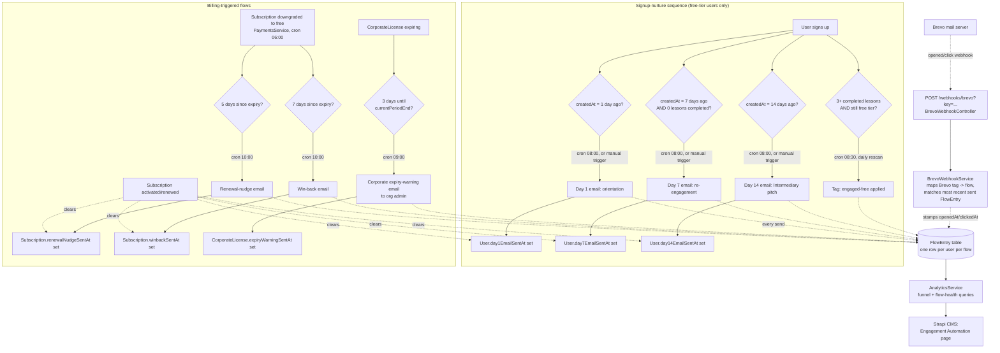

# Engagement Automation — Architecture

This documents the finished system: what triggers each flow, what it reads
and writes, and how a user moves through it. See `lifecycle.service.ts` for
the implementation and `analytics.service.ts` for the reporting queries
this diagram's data ultimately feeds.

## Flow map

## Why two flags per email, not one

Every send-based flow (everything except `engaged-free-tagging`) is guarded
by **two** independent mechanisms that serve different purposes:

1. **A nullable `sentAt` timestamp** on the row that owns the business state
   (`User.day1EmailSentAt`, `Subscription.winbackSentAt`, etc). This is the
   dedupe: it's what stops the daily cron from re-sending the same email
   every day within the eligibility window. It's cleared on the state
   transition that makes the email irrelevant again (e.g. renewal clears
   both `winbackSentAt` and `renewalNudgeSentAt`).
2. **A `FlowEntry` row**, written the moment a user becomes eligible (before
   the send is attempted), completed with an outcome once the send
   resolves. This is the audit trail and reporting substrate — it's what
   the funnel chart, flow-health table, and daily-volume chart all read.
   It is never cleared or overwritten; a user's full history through every
   flow stays queryable forever, even after their `sentAt` flag resets.

Concretely: if a user gets Day 14, upgrades, cancels months later, and
lapses into `renewal-nudge` eligibility again — the `sentAt` flags will
correctly reflect only their *current* cycle's state, while `FlowEntry`
still shows every past pass through every flow, in order, for anyone
looking at their history.

## Manual trigger: how backfill differs from the daily cron

The three signup-nurture flows (Day 1/7/14) are backed by a shared
`run*Nurture(extraWhere)` method. The `@Cron` handlers call it with
`{ createdAt: { gte: <exact day>, lt: <next day> } }` — this is why the
cron alone can only ever reach "today's" cohort. The manual-trigger admin
endpoint (`POST /admin/lifecycle/trigger/:flow`) calls the *same* method
with **no** `createdAt` filter at all, so it reaches every user who is
eligible right now regardless of signup date — the one gap a purely
date-driven cron can't close on its own, needed both for backfilling users
who existed before this system shipped and for re-running a flow on demand
without waiting for the next scheduled window.

## Click/open tracking

Every send passes a `tags: [...]` array to Brevo (e.g. `['lifecycle-day14']`)
purely for Brevo's own dashboard analytics - `BREVO_TAG_TO_FLOW` in
`brevo-webhook.service.ts` is the one place that reconciles those tag
strings back to `FlowEntry.flow` values, since the two vocabularies were
never meant to be identical. When a webhook event arrives:

1. Match the event's `email` to a `User` row.
2. Map the event's `tags` to a `LifecycleFlow` via `BREVO_TAG_TO_FLOW`.
3. Find that user's most recent `FlowEntry` for that flow with
   `outcome: 'sent'` (there is always at most one live one, given the
   `sentAt` dedupe on the owning row).
4. Stamp `openedAt` (on an `opened` event) or `openedAt`+`clickedAt`+
   `clickedUrl` (on a `click` event - a click implies an open even if the
   separate open-pixel event was lost, a known quirk of some mail clients).

**Setup step required outside this codebase**: Brevo doesn't push these
events anywhere until a webhook is configured in the Brevo dashboard
(Transactional → Settings → Webhooks), pointed at
`https://<api-host>/webhooks/brevo?key=<BREVO_WEBHOOK_SECRET>` for the
`opened` and `click` event types. This is a manual one-time step - there is
no Brevo API call in this codebase that registers a webhook automatically.

Not every transactional email is flow-tracked - `subscription-confirmed`,
`subscription-expiring-soon`, and every non-lifecycle tag (referrals,
corporate invites, ebook delivery) have no `FlowEntry` equivalent, so a
click on those is currently just ignored rather than recorded anywhere.

## A/B testing on the two money emails

`day14-nurture` (the first direct paid pitch) and `winback` (the last
recovery attempt) each have two variants - genuinely different sales
angles, not copy tweaks, since the whole point is to learn something from
a difference in results:

- **Day 14**: `trade-journal` (the original angle - fee tracking) vs.
  `stock-advisor` (leads with the Premium-tier advisor/fit-score pitch
  instead).
- **Winback**: `data-still-there` (original - reassurance about account
  continuity) vs. `social-proof` (points at the real, visitable Financial
  Advisors directory rather than a fabricated stat - the brand's voice
  rules explicitly ban vague hype like "thousands of investors").

**Assignment** (`ab-variant.util.ts`) is a deterministic hash of
`userId + testName`, not `Math.random()` - the same user always gets the
same variant, with nothing to persist or look up to guarantee that. The
variant is written into `FlowEntry.metadata.variant` at entry time (before
the send is attempted) and also appended to the Brevo `tags` array as
`variant:<name>`, so it's visible in Brevo's own dashboard too.

**Results** (`AnalyticsService.getVariantResults`) aggregate sent/opened/
clicked/converted per variant. "Converted" means the user currently holds
an active paid subscription - for Day 14 that's a direct read on whether
the pitch worked; for winback it specifically measures reactivation, the
only outcome that email is trying to produce.

## Table of flows

| Flow | Cron | Eligibility | Terminal action | Dedupe field |
|---|---|---|---|---|
| `day1-nurture` | `0 8 * * *` | Free tier, signed up 1 day ago | Orientation email | `User.day1EmailSentAt` |
| `day7-nurture` | `0 8 * * *` | Free tier, signed up 7 days ago, 0 completed lessons | Re-engagement email | `User.day7EmailSentAt` |
| `day14-nurture` | `0 8 * * *` | Free tier, signed up 14 days ago | Intermediary pitch email | `User.day14EmailSentAt` |
| `engaged-free-tagging` | `30 8 * * *` | Free tier, 3+ completed lessons, not already tagged | Apply `engaged-free` tag | UserTag row itself (idempotent) |
| `corporate-expiry-warning` | `0 9 * * *` | Active license, expires within 3 days | Email to org admin | `CorporateLicense.expiryWarningSentAt` |
| `renewal-nudge` | `0 10 * * *` | Personal sub lapsed to free 5-6 days ago | Renewal check-in email | `Subscription.renewalNudgeSentAt` |
| `winback` | `0 10 * * *` | Personal sub lapsed to free 7-8 days ago | Win-back email | `Subscription.winbackSentAt` |

Only the first three (`day1/7/14-nurture`) support the manual-trigger
backfill — the rest are already fully state-driven and re-evaluate the
entire user base on every cron run, so there is no "today's cohort" gap
for them to backfill in the first place.
